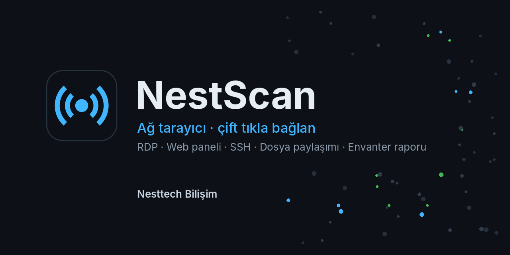
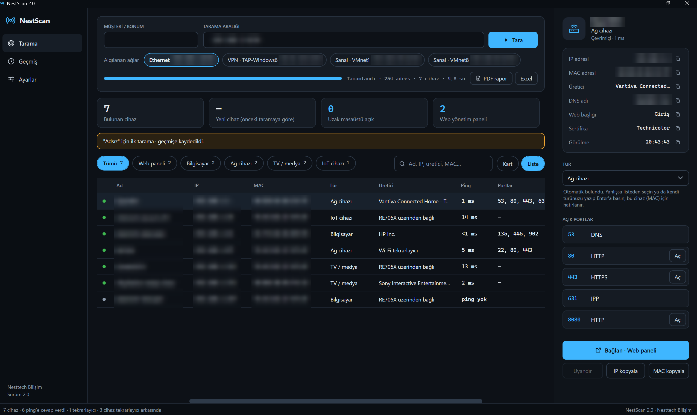
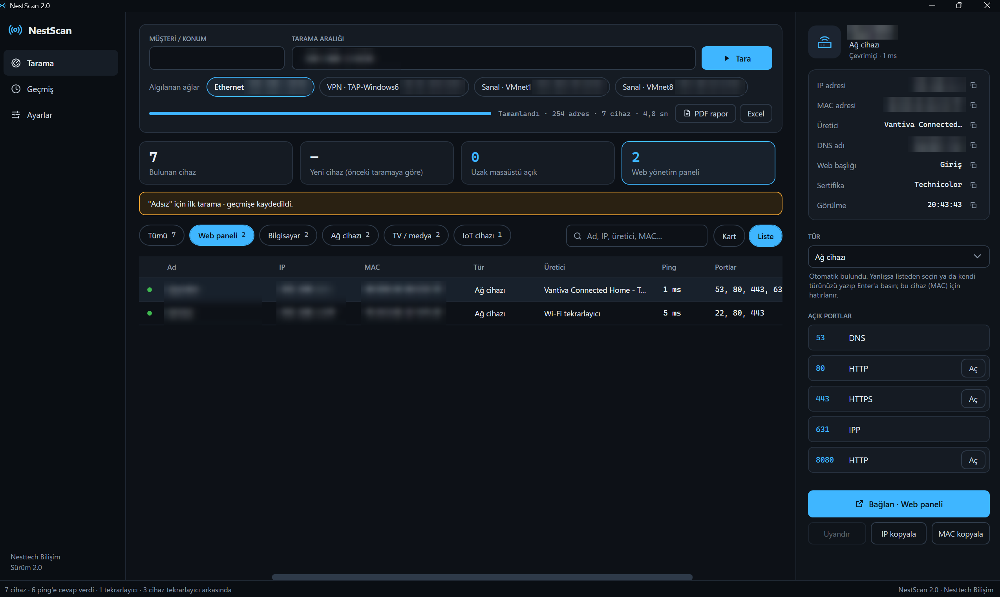
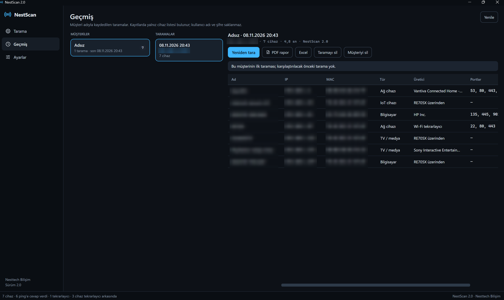

  

  <a href="https://github.com/Nesttech-Bilisim/nestscan/releases/latest"><b>⬇️ NestScan'i indir</b></a> ·
  <a href="#english">English</a> ·
  <a href="https://nesttechbilisim.com">nesttechbilisim.com</a>

---

**NestScan**, yerel ağdaki cihazları saniyeler içinde bulan, ne olduklarını tanıyan ve çift tıkla bağlanmanızı sağlayan
ücretsiz bir Windows ağ tarayıcısıdır. Sahada IT desteği veren ekipler için, sahada geliştirildi.

## Özellikler

- **Hızlı tarama:** /24 ağ yaklaşık 8 saniyede taranır; ağ kartları otomatik algılanır.
- **Cihazı tanır:** bilgisayar, sunucu, VMware ESXi/vCenter, NAS, switch, erişim noktası, yazıcı, kamera, mobil cihaz…
  Ad; Windows (NetBIOS), DNS, web paneli başlığı ve sertifikasından bulunur.
- **Çift tıkla bağlan:** Uzak Masaüstü, web paneli, SSH, dosya paylaşımı. Cihaz türüne göre doğru bağlantı açılır.
- **Şifre saklamaz:** kullanıcı adı ve şifre her bağlantıda yeniden girilir; hiçbir yere kaydedilmez.
- **Müşteri bazlı geçmiş:** taramalar müşteri/konum adıyla saklanır; yeni ve kaybolan cihazlar gösterilir.
- **Envanter raporu:** tek tıkla PDF ve Excel.
- **Tür düzeltme:** yanlış tanınan cihazın türü elle seçilir ya da kendi türünüz yazılır; cihaz (MAC) için hatırlanır.
- **Wake-on-LAN**, IP/MAC kopyalama, koyu ve açık tema.

## Ekran görüntüleri

   
  Tarama sonucu: cihaz listesi, türler ve detay paneli  
   
  Özet kutusuna tıklayınca liste süzülür (burada: web yönetim paneli olan cihazlar)  
   
  Müşteri bazlı tarama geçmişi, PDF/Excel rapor

## Kurulum

1. [Son sürüm sayfasından](https://github.com/Nesttech-Bilisim/nestscan/releases/latest) `NestScan-x.y-Kurulum.exe` dosyasını indirin.
2. Açılan pencerede seçin:
   - **Kurun:** bilgisayara kurar (Başlat menüsü, masaüstü kısayolu, Denetim Masası'ndan kaldırma).
   - **Çalıştır:** kurmadan açar; bilgisayara bir şey eklenmez. Müşteride tek seferlik tarama için.
3. Yönetici yetkisi gerekmez. .NET ayrıca kurulmaz, dosyanın içindedir.

> **"Windows bilgisayarınızı korudu" uyarısı çıkarsa:** **Ek bilgi → Yine de çalıştır**'a tıklayın.
> NestScan yeni bir uygulama olduğu için Windows SmartScreen henüz tanımıyor. Dosyanın değişmediğini sürüm
> sayfasındaki SHA-256 özetiyle kontrol edebilirsiniz.

Kurulumsuz kullanım için sürüm sayfasında `NestScan-x.y-Tasinabilir.zip` de bulunur (USB bellekten çalışır).

**Sistem gereksinimi:** Windows 10 veya 11, 64 bit.

## Gizlilik ve güvenlik

- NestScan internete veri göndermez; tarama yalnız seçtiğiniz yerel ağda yapılır.
- Şifre ve kullanıcı adı **saklanmaz**. Uzak Masaüstü için Windows'a verilen geçici kimlik bilgisi 60 saniye içinde
  silinir, bağlantı geçmişi temizlenir.
- Tarama geçmişi, ayarlar ve elle seçilen cihaz türleri yalnız bilgisayarınızda, `%LOCALAPPDATA%\NestScan`
  klasöründe tutulur. Geçmiş kaydı Ayarlar'dan kapatılabilir.

> NestScan'i yalnız yönetme yetkiniz olan ağlarda kullanın.

## Geri bildirim

Yanlış tanınan bir cihaz ya da bir hata gördüyseniz [Issues](https://github.com/Nesttech-Bilisim/nestscan/issues)
bölümüne yazın veya **destek@nesttechbilisim.com** adresine e-posta gönderin. Cihaz tanıma için ayrıntı panelindeki
Üretici, Web başlığı ve Sertifika satırlarının ekran görüntüsü çok yardımcı olur (müşteri adı/IP gibi bilgileri
kapatarak).

Sürümlerde neyin değiştiği: [SURUMLER.md](SURUMLER.md)

## Lisans

NestScan ücretsizdir; kişisel ve ticari kullanımda serbesttir. Kaynak kodu kapalıdır.
Ayrıntılar: [LICENSE.md](LICENSE.md) · © 2026 Nesttech Bilişim

---

## English

**NestScan** is a free network scanner for Windows. It finds the devices on your local network in seconds, identifies
what they are (PC, server, VMware ESXi, NAS, switch, access point, printer, camera…) and opens the right connection
with a double click: Remote Desktop, web panel, SSH or file share.

- No passwords are stored, ever. Credentials are typed in for each connection.
- Scan history per customer/site, with new and missing devices highlighted.
- One-click PDF and Excel inventory reports.
- Install it, or run it without installing (portable).

**Download:** [latest release](https://github.com/Nesttech-Bilisim/nestscan/releases/latest) ·
**Requirements:** Windows 10/11 64-bit · The user interface is in Turkish.

If Windows SmartScreen warns about the file, click **More info → Run anyway**.

Feedback: [Issues](https://github.com/Nesttech-Bilisim/nestscan/issues) or **destek@nesttechbilisim.com**.
NestScan is freeware (closed source). © 2026 Nesttech Bilişim.
